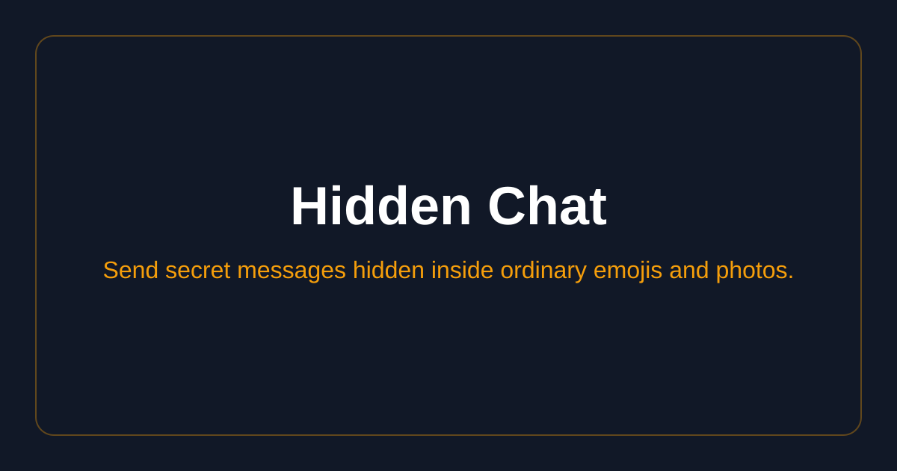
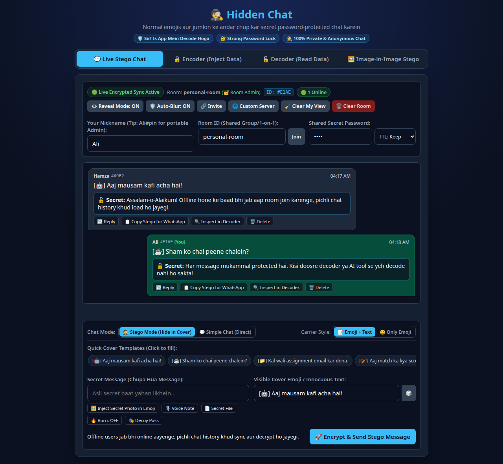

[](https://github.com/mrabr381/Hidden-Chat-) [](https://www.buymeacoffee.com/muhammadabubakar)

# 🕵️ Hidden Chat

Send secret messages hidden inside ordinary emojis and photos.

🌐 **Live site:** [https://hidden-chaat.netlify.app/](https://hidden-chaat.netlify.app/)



*Screenshot of the live site — the stego chat room with encrypted messages hidden inside innocent cover phrases.*

**Hidden Chat** is a privacy-first, real-time messenger and steganography studio by [**@mrabr381**](https://github.com/mrabr381). It hides password-encrypted messages, original-quality photos, voice notes, and secret documents inside ordinary emojis and casual everyday phrases (zero-width carriers) or inside image pixels, and lets you chat in real time inside zero-metadata hashed rooms.

## ✨ What it does

- **💬 Real-time encrypted chat, two modes:** Stego Mode hides your encrypted message inside an innocent cover phrase (e.g. `[🤖] Aaj mausam kafi acha hai!`) or an emoji-only carrier; Simple Chat works like a clean direct chat while keeping every message encrypted in the background.
- **🟢 Live presence & typing indicator:** shows the active room member count and an encrypted typing indicator without exposing identities.
- **↩️ Encrypted replies & single-message delete:** quote-reply to any message, or delete individual messages for everyone (sender and Room Admin).
- **🔗 Zero-knowledge invite links:** shareable `#room=...` links — the room name stays in the URL hash fragment and is never sent to any web server.
- **👑 Portable Room Creator (Admin) protection:** only the original room creator can clear the whole room history; Admin rights travel across devices via Nickname + Room Password or `Nickname#pin` (e.g. `Ali#786`).
- **👥 Same-nickname disambiguation:** every user gets a unique cryptographic ID tag (e.g. `Ali #A9F2`).
- **🔥 Burn-on-Read:** optional self-destruct messages — a live 10-second countdown starts only after a receiver unlocks and reads the message, then it is permanently deleted from Firebase and local storage.
- **🎭 Decoy / dual password (duress mode):** attach a secondary fake password and fake message; if forced to reveal a password, the decoy unlocks a harmless cover message while the real secret stays hidden.
- **🛡️ Auto tab-blur & panic stealth:** the chat blurs the instant you switch tabs or click outside the window; pressing `Esc` (or 15 minutes of inactivity) switches all bubbles back to innocent cover text.
- **🖼️ Image-in-image steganography:** a dedicated tab hides password-encrypted messages inside the RGB pixel Least Significant Bits (LSB) of any PNG/JPG image and exports a lossless Stego PNG.
- **🎙️ Voice notes & 📄 documents in emoji:** record up to 15-second voice notes (encrypted with `AES-256-GCM`) or hide `.pdf`, `.txt`, `.zip`, `.doc/.docx`, `.csv`, or `.json` files (up to 2.5 MB) inside an emoji carrier.
- **📲 Installable app (PWA):** Web App Manifest (`manifest.json`) and offline Service Worker (`sw.js`) let you install Hidden Chat on Android, iOS, Windows, or macOS.
- **🛡️ App-exclusive decoder lock:** bit-stream scrambling + dual-layer key derivation (`PBKDF2` 210,000 SHA-256 iterations + `AES-256-GCM`) so external zero-width decoders and AI tools cannot extract hidden payloads.

## 📋 Requirements

1. **A modern web browser:** Chrome, Edge, Brave, Firefox, or Safari (supports the native Web Crypto API `window.crypto.subtle` and `MediaRecorder`).
2. **A free Firebase account (optional):** [Firebase Spark Plan (free tier)](https://console.firebase.google.com/) for Realtime Database live multi-device sync. Without Firebase configured, the app automatically runs in **Instant Local / Multi-Tab Demo Mode**.
3. **Node.js v18+ (optional):** only needed to deploy from your terminal using `firebase-tools` or `netlify-cli`. No Node.js is required for **Netlify Drag & Drop** or **GitHub Pages**.

## ⚡ Quick clone & run locally

```bash
git clone https://github.com/mrabr381/Hidden-Chat-.git
cd Hidden-Chat-
# Open index.html directly in your browser or serve locally:
npx serve .
```

## 🗄️ Free Firebase Realtime Database setup

1. Open the [Firebase Console](https://console.firebase.google.com/) and create a project (you can disable Google Analytics for faster setup).
2. Go to **Build > Realtime Database**, click **Create Database**, pick a region and choose **Start in test mode**, then click **Enable**.
3. Copy your database URL (e.g. `https://your-project-default-rtdb.firebaseio.com`) and connect it in the app via **🌐 Custom Server** in the top bar — paste the URL and click **Connect Custom DB**. (Self-hosted alternative: set `DEFAULT_FIREBASE_CONFIG` in `index.html` with your project credentials — never commit real API keys to a public repo; see `.env.example`.)
4. In the Firebase Console, open **Realtime Database > Rules**, paste the contents of [`database.rules.json`](./database.rules.json) from this repository, and click **Publish**.

## 🚀 Deployment

- **Netlify (recommended — like the live demo):** import the repo at [Netlify](https://app.netlify.com/) (build command blank, publish directory `.`), or drag and drop the folder onto [Netlify Drop](https://app.netlify.com/drop). `netlify.toml` configures the production security headers automatically.
- **Firebase Hosting:** `npm install -g firebase-tools`, `firebase login`, `firebase use --add`, `firebase deploy`.
- **GitHub Pages:** push to your repo, then **Settings > Pages > Deploy from a branch**, choose `main` and `/ (root)`. Note: Pages is not enabled on this repo yet — until it is, `https://mrabr381.github.io/Hidden-Chat-/` returns 404.

## 🔒 Security highlights

- **Zero hardcoded secrets in repo:** template configuration with `.gitignore` and `.env.example` so credentials never leak in Git history.
- **Strict file upload verification:** validates binary magic bytes (`PNG`, `JPEG`, `GIF`, `WEBP`) and strict MIME allowlists, blocking SVG/HTML/script uploads disguised with fake extensions.
- **XSS & injection defense:** all dynamic values are HTML-escaped, input lengths are strictly bounded, and media previews only render verified base64 data URIs.
- **SSRF protection:** custom database connections validate HTTPS and allow only official `*.firebaseio.com` and `*.firebasedatabase.app` domains.
- **Production security headers:** pre-configured `Content-Security-Policy`, `Strict-Transport-Security` (HSTS), `X-Frame-Options`, `X-Content-Type-Options`, `Permissions-Policy`, and `Referrer-Policy` in `netlify.toml` and `firebase.json`.

## 📜 License & copyright

Copyright © 2026 [**mrabr381**](https://github.com/mrabr381). All rights reserved.
Licensed under the **Non-Commercial Personal & Educational Use License** — commercial use, monetization, or sale of this software is strictly prohibited. See [`LICENSE`](./LICENSE) for full details.

## ⚖️ Disclaimer

This project is developed for personal privacy, cryptographic research, and educational purposes. Users are solely responsible for complying with local laws and regulations.
